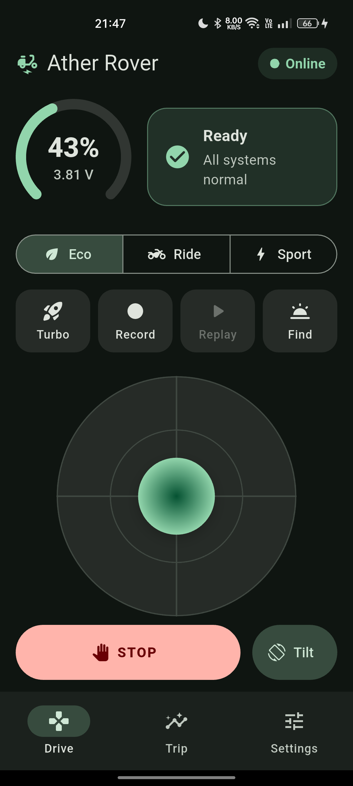
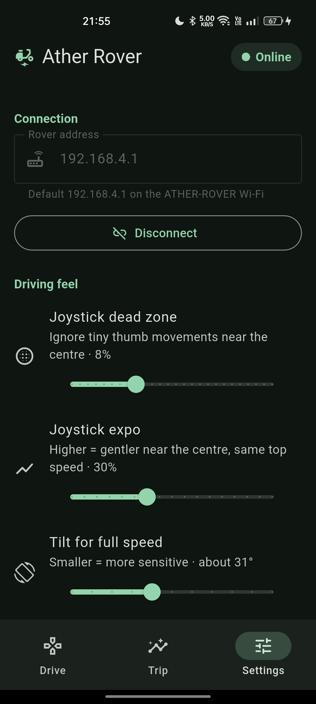

# 🛞 ESP32 Wi-Fi Rover

An ESP32-powered rover you drive from your phone over Wi-Fi. Built at the **Ather Forge Hackathon** at PES University.

The rover creates its own Wi-Fi network — the phone joins it and the Flutter app drives the rover over a WebSocket. **No internet and no router needed.**

```
Phone (Flutter app) ──Wi-Fi, WebSocket port 81──▶ ESP32 ──PWM──▶ DRV8833 ──▶ 2 motors
```

## 📱 App Screenshots

<p align="center">
  
  &nbsp;&nbsp;
  
  &nbsp;&nbsp;
  
</p>

## 📂 Project Structure

```
ather_rover/          ← v1: original hackathon build
  ├── firmware/       ESP32 Arduino sketch
  ├── app/            Flutter app
  └── hardware/       KiCad PCB schematic

ather_rover_v2/       ← v2: battery LED + web monitor additions
ather_rover_v3/       ← v3: full rewrite – trip stats, settings, tilt steering
```

## ⚡ Quick Start

### 1. Flash the firmware

1. Arduino IDE → install **esp32 by Espressif v3.x**.
2. Library Manager → install **WebSockets** by Markus Sattler.
3. Open `ather_rover/firmware/rover_firmware/rover_firmware.ino`, board: **ESP32 Dev Module**.
4. Upload (battery switch OFF while USB is connected).

**Pins:** IN1=32, IN2=33, IN3=25, IN4=26, battery sense=34, SLP → 3V3.
Wi-Fi: `Ather` / `123456789` (change at the top of the sketch).

### 2. Build the app

```bash
cd ather_rover_v3/app
flutter pub get
flutter run
```

Needs Flutter 3.22+.

### 3. Drive!

1. Power the rover. Join Wi-Fi **Ather** on the phone.
2. If prompted "no internet", stay connected and turn **mobile data off**.
3. Open the app — it auto-connects to `192.168.4.1:81`.
4. Joystick drives, **STOP** stops, **Eco / Ride / Sport** sets power and acceleration.

## 🔧 Features

| Feature | Detail |
|---|---|
| **Ride modes** | Eco 40%, Ride 70%, Sport 100% power — each with its own acceleration ramp |
| **Fail-safe** | No command for 400 ms → motors stop. App heartbeat every 50 ms |
| **Tilt steering** | Drive by tilting the phone (configurable sensitivity) |
| **Turbo** | Hold for temporary full power override |
| **Trip stats** | Drive time, battery used, lowest voltage, recorded path, voltage chart |
| **Limp mode** | Below 3.5 V → power capped at 30% |
| **Battery cut-off** | Below 3.3 V → motors stop until reboot |
| **OTA update** | Arduino OTA from laptop over the rover's Wi-Fi |
| **Record & Replay** | Record a drive path, replay it autonomously |
| **Find rover** | Blink/beep to locate |

## 📡 Protocol

```
App → Rover:   D,<x>,<y>  drive (-1..1)  |  M,<0|1|2>  mode  |  S  stop
Rover → App:   T,<volts>,<percent>,<mode>,<state>,<fw>   (2 Hz)
```

## 🔌 Hardware

- **MCU:** ESP32 Dev Module
- **Motor driver:** DRV8833
- **Motors:** 2× DC gear motors
- **Battery:** 3.7 V Li-ion (with optional voltage divider on GPIO34)
- **PCB:** KiCad schematic in `ather_rover/hardware/`

## 📄 License

Personal project — built at the Ather Forge Hackathon, PES University, November 2026.
