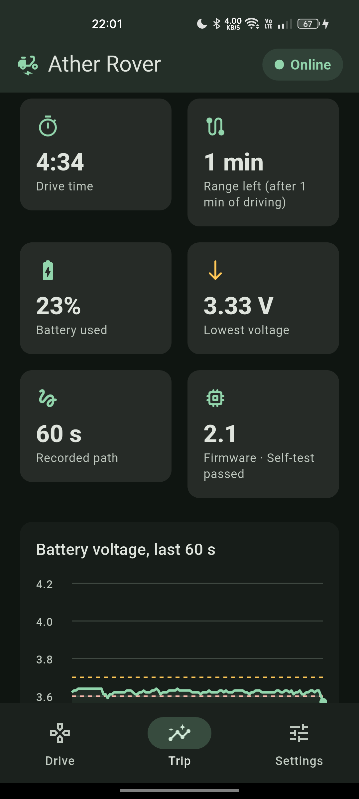

# ESP32 Wi-Fi Rover

A phone-controlled rover built at the **Ather Forge Hackathon** (PES University, November 2026). The ESP32 creates its own Wi-Fi network — the phone joins it and a Flutter app drives the rover over a WebSocket. **No internet, no router, no pairing — just power on and drive.**

<p align="center">
  
  &nbsp;&nbsp;
  
  &nbsp;&nbsp;
  
</p>

---

## Contents

- [Features](#features)
  - [Firmware (ESP32)](#firmware-esp32)
  - [App (Flutter, Android/iOS)](#app-flutter-androidios)
- [How it works](#how-it-works)
- [Hardware](#hardware)
- [Getting started](#getting-started)
  - [1. Flash the firmware](#1-flash-the-firmware)
  - [2. Build the app](#2-build-the-app)
  - [3. Drive](#3-drive)
- [Protocol](#protocol)
- [Testing](#testing)
- [Project structure](#project-structure)
- [Safety and security notes](#safety-and-security-notes)
- [Roadmap](#roadmap)
- [License](#license)
- [Acknowledgements](#acknowledgements)

---

## Features

### Firmware (ESP32)

| Feature | Detail |
|---|---|
| **Wi-Fi Access Point** | Creates its own network (`Ather` / `123456789`) — no router needed |
| **WebSocket server** | Real-time bidirectional communication on port 81 |
| **Ride modes** | Eco (40% power), Ride (70%), Sport (100%) — each with its own acceleration ramp |
| **Fail-safe** | No command for 400 ms → motors stop immediately. App heartbeat every 50 ms |
| **Limp mode** | Below 3.5 V → power capped at 30% |
| **Battery cut-off** | Below 3.3 V → motors stop and stay stopped until reboot |
| **Smooth ramping** | Motor power ramps up/down gradually per ride mode to prevent jerky starts |
| **OTA updates** | Arduino OTA: upload new firmware over Wi-Fi from your laptop |
| **Dual core compatibility** | Works with both ESP32 Arduino core 2.x and 3.x |

### App (Flutter, Android/iOS)

| Feature | Detail |
|---|---|
| **Virtual joystick** | Touch joystick with configurable dead zone and expo curve |
| **Tilt steering** | Drive by tilting the phone — calibrates to your holding pose on activation |
| **Battery gauge** | Live voltage and percentage with animated arc |
| **Ride mode selector** | Tap to switch between Eco / Ride / Sport |
| **Turbo** | 3 s burst of full power, then 10 s cool-down |
| **Record & Replay** | Record up to 60 s of driving, replay it autonomously |
| **Find rover** | Flash the rover's lights to locate it |
| **Trip stats** | Drive time, battery used, lowest voltage, recorded path duration, firmware version |
| **Voltage chart** | Live battery voltage over the last 60 s |
| **Settings** | Rover address, joystick dead zone, joystick expo, tilt sensitivity |
| **Auto-reconnect** | Automatically reconnects when connection drops |
| **Responsive layout** | Portrait (stacked) and landscape/tablet (side-by-side) layouts |
| **Haptic feedback** | Vibration on controls for a tactile feel |
| **Onboarding** | First-launch screen with Wi-Fi setup instructions |

---

## How it works

```
Phone (Flutter app) ──Wi-Fi──▶ ESP32 Access Point (192.168.4.1)
                     WebSocket :81
                         │
                    D,x,y  M,mode  S
                         │
                    ┌─────▼─────┐
                    │   ESP32   │
                    │ Diff-mix  │
                    │   Ramp    │
                    └─────┬─────┘
                     PWM 20 kHz
                    ┌─────▼─────┐
                    │  DRV8833  │
                    └──┬─────┬──┘
                 Motor A   Motor B
```

1. The ESP32 boots and creates a Wi-Fi network.
2. The phone joins the network and the app opens a WebSocket to `ws://192.168.4.1:81`.
3. The joystick (or tilt sensor) sends `D,<x>,<y>` commands at ~50 Hz, where x = steer (−1…1) and y = throttle (−1…1).
4. The firmware mixes x and y into differential drive (left = y+x, right = y−x), applies the ride-mode power cap, ramps smoothly, and outputs 20 kHz PWM to the DRV8833 motor driver.
5. The rover sends telemetry back at 2 Hz: `T,<volts>,<percent>,<mode>,<state>,<fw>`.

---

## Hardware

| Component | Part | Notes |
|---|---|---|
| **MCU** | ESP32 Dev Module | Wi-Fi AP + WebSocket server |
| **Motor driver** | DRV8833 | Dual H-bridge, SLP pin tied to 3V3 |
| **Motors** | 2× DC gear motors | Differential drive (tank steering) |
| **Battery** | 3.7 V Li-ion | Optional voltage divider (2×100 kΩ) on GPIO 34 |
| **PCB** | Custom (KiCad) | Schematic in `ather_rover/hardware/` |

**Pin mapping:**

| Function | GPIO |
|---|---|
| Motor A IN1 | 32 |
| Motor A IN2 | 33 |
| Motor B IN3 | 25 |
| Motor B IN4 | 26 |
| Battery sense | 34 |
| DRV8833 SLP | 3V3 |

> [!TIP]
> If a motor spins backwards, either swap its two wires or set `INVERT_A` / `INVERT_B` to `true` in the firmware.

---

## Getting started

### 1. Flash the firmware

1. Install [Arduino IDE](https://www.arduino.cc/en/software).
2. Board Manager → install **esp32 by Espressif, version 3.x**.
3. Library Manager → install **WebSockets** by Markus Sattler.
4. Open `ather_rover/firmware/rover_firmware/rover_firmware.ino`.
5. Select board: **ESP32 Dev Module**.
6. If you did not fit the two 100 kΩ battery resistors on GPIO 34, make sure `HAVE_DIVIDER = false` (the default).
7. Upload (**battery switch OFF** while USB is connected).

### 2. Build the app

```bash
cd ather_rover_v3/app
flutter pub get
flutter run            # or: flutter build apk
```

> [!NOTE]
> Requires Flutter 3.22+ and Dart SDK ≥3.4.0. The app uses `web_socket_channel`, `sensors_plus`, and `shared_preferences`.

For a release APK, make sure this line is in `android/app/src/main/AndroidManifest.xml`:

```xml
<uses-permission android:name="android.permission.INTERNET"/>
```

### 3. Drive

1. Power on the rover.
2. On the phone, join Wi-Fi **`Ather`** (password `123456789`).
3. If the phone warns "no internet", choose **Stay connected** and turn **mobile data off** so Android doesn't route traffic away from the rover.
4. Open the app — it auto-connects to `192.168.4.1:81`.
5. Use the joystick to drive. Tap **STOP** to emergency stop.
6. Switch between **Eco / Ride / Sport** for different power and acceleration levels.

---

## Protocol

Plain text over WebSocket (port 81).

**App → Rover:**

| Message | Description |
|---|---|
| `D,<x>,<y>` | Drive command. x = steer, y = throttle, both −1.0 … 1.0 |
| `M,<0\|1\|2>` | Set ride mode: 0 = Eco, 1 = Ride, 2 = Sport |
| `S` | Emergency stop |

**Rover → App** (every 500 ms):

| Message | Description |
|---|---|
| `T,<volts>,<percent>,<mode>,<state>,<fw>` | Telemetry frame |

State values: `OK`, `FAILSAFE`, `LIMP`, `LOWBATT`.

---

## Testing

The v3 app includes unit tests for the core logic:

```bash
cd ather_rover_v3/app
flutter test
```

| Test file | Covers |
|---|---|
| `drive_math_test.dart` | Dead zone, expo curve, joystick shaping, tilt-to-drive, unit circle clamping |
| `protocol_test.dart` | Telemetry parsing, command formatting |
| `rover_controller_test.dart` | Connection state machine, mode switching, fail-safe |
| `settings_test.dart` | Settings persistence and defaults |

The firmware was tested with stand-in Arduino headers — drive directions, mode limits, fail-safe, telemetry format, and battery cut-off all pass simulation.

---

## Project structure

```
├── screenshots/              App screenshots for this README
├── ather_rover/              v1 — original hackathon build
│   ├── firmware/             ESP32 Arduino sketch
│   │   └── rover_firmware/
│   ├── app/                  Flutter app (single-file, basic joystick)
│   │   └── lib/
│   ├── hardware/             KiCad PCB schematic & layout
│   │   └── rover-circuit/
│   └── README.md             Detailed v1 README
│
├── ather_rover_v2/           v2 — added battery LED indicators + web battery monitor
│   └── ather_rover/
│       ├── firmware/
│       └── app/
│
└── ather_rover_v3/           v3 — full rewrite
    └── app/
        ├── lib/
        │   ├── core/         drive_math, protocol, transport (WebSocket)
        │   ├── state/        rover_controller, settings_controller
        │   └── ui/
        │       ├── screens/  drive, trip, onboarding, settings
        │       └── widgets/  joystick, battery_gauge, voltage_chart, status
        └── test/             Unit tests
```

---

## Safety and security notes

> [!CAUTION]
> - **Battery switch OFF** while USB is connected — do not charge and drive simultaneously.
> - The Wi-Fi password is hardcoded in plaintext in the firmware. Change it before using in public.
> - The WebSocket has **no authentication** — anyone on the rover's Wi-Fi can send commands.
> - The rover is a hackathon prototype, **not a production device**. Use at your own risk.

- The firmware has a 400 ms fail-safe: if the app disconnects or crashes, the motors stop automatically.
- Battery cut-off at 3.3 V prevents over-discharge of the Li-ion cell.
- OTA updates stop the motors before flashing begins.

---

## Roadmap

- [ ] Encrypted WebSocket (WSS) with authentication
- [ ] Camera feed (ESP32-CAM module)
- [ ] Speed/distance odometry from motor encoders
- [ ] Obstacle avoidance with ultrasonic sensor
- [ ] Multi-rover support (connect to multiple rovers)
- [ ] iOS build and TestFlight distribution
- [ ] 3D-printed chassis design files

---

## License

Personal project — built at the Ather Forge Hackathon, PES University, November 2026.

---

## Acknowledgements

- **Ather Energy** — for hosting the hackathon
- **PES University** — venue and support
- [WebSockets by Markus Sattler](https://github.com/Links2004/arduinoWebSockets) — ESP32 WebSocket library
- [sensors_plus](https://pub.dev/packages/sensors_plus) — accelerometer for tilt steering
- [web_socket_channel](https://pub.dev/packages/web_socket_channel) — Dart WebSocket client
